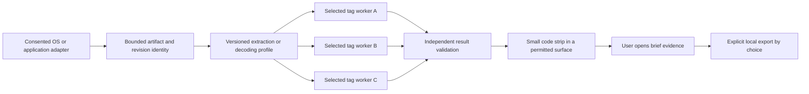

# Quiet device layer and independent multimodal tags

Architecture plan · 2026-11-16 · CTO lane: Codex · Accountable operator: Michael.

This document preserves the broad product: small, understandable tags on the content people encounter, with independent methods, evidence and validation for each tag. It describes the implementation seams needed to expand that product across applications and formats. It does not activate capture, install an extension, adopt new codes, publish an endpoint, enable research collection or establish detector accuracy.

## 1. Product contract

A person can receive several tags for the same artifact because the tags answer different questions. The quiet layer obtains only permitted content, identifies the artifact/revision, dispatches the selected applicable methods and displays each result independently. Opening a tag reveals a short explanation; its full method, limitations, measured performance and setup belong in its reference/modal. No content is covered by a persistent evidence box.

The presentation surface is separate from the evidence engine. A browser adapter, an iPhone Share extension and a cooperating application's integration may present the same method's result. None makes that method more accurate. A supported extraction profile is separate again: OCR or a VLM can produce observations from an image but cannot establish human authorship, AI generation, factual truth or harmlessness by recognizing its contents.

Each tag owns its baseline question, accepted input profiles, independent evidence sources, transformations, method/model identity, uncertainty policy, output, resource budget, category tests and release gate. A tag never requires another tag's verdict to function. A shared security prerequisite, such as redaction on the existing service route, must be disclosed rather than silently bypassed.

## 2. Current implementation, inspected before this plan

| Existing component | Working bounded job | Limit that must stay visible |
| --- | --- | --- |
| `scripts/check-tags.py` | Independently launches explicitly selected PS and PII checks, preserves separate records and reports partial failure | These are the only selected codes in that coordinator; it is not fourteen working tags |
| `services/gateway/app.py` | Separate admission pools for full and privacy-only work; explicit dependency/refusal states | Text-only evaluation; the combined route requires redaction and evaluation; all pools share a host/process |
| `extension/manifest.json`, `extension/src/adapters/chatgpt.js` | Declared ChatGPT DOM adapter, revision-bound response checking after local consent | Not every site or native application; MAIN-world stream component is not installed |
| `extension/src/content/badge.js` | Compact code buttons, closed shadow-root styling, on-demand evidence | Not spoof-proof or a general OS overlay; the host page can remove or imitate presentation |
| `mobile/ios/Source/ShareController.swift` | One explicitly supplied text item, review before Check, bounded/refused delivery and cancellation | Provider compatibility and complete current source-bound workflow acceptance remain distinct from physical iPhone/VoiceOver acceptance |
| `tools/host_capture.py` | Foreground observation of one explicitly selected private text file, optional independent PS worker | Not clipboard, keyboard, screen, recursive-folder or whole-device monitoring |
| `tools/manifest_inspection.py` | Actual optional pinned C2PA SDK inspection of an attached manifest in a bounded PNG | No origin tag, truthful-content claim, JPEG support, watermark reader or complete revocation clearance |
| `services/adjudicator/verdict.py`, `adjudicate.py`, `tag_bridge.py` | Typed research interpretation and conflict handling over supplied observations | These modules do not themselves read files or verify signatures, watermarks, trust chains or issuer responses; upstream verification flags are not independent evidence |
| `protocol/reserved_subjects.py` and `.cjs` | Reproducible subject/coordinate contracts for explicitly prepared artifacts | Not encoded-file decoders or multimodal detectors |

F-006 and F-154 are complete reservation/subject-contract jobs, not complete detection in all six formats. F-025 is complete for its declared PNG inspection job. F-155 and the FA/PA tag packages retain broader watermark/origin work. The current runtime profile is recorded in `spec/subject-profiles.json`.

References: [tag isolation](tag-failure-isolation-plan.md), [actual isolation and limitations](tag-failure-isolation-result.md), [manifest inspection](manifest-inspection.md), [subject contracts](subject-contract.md), [prepared-artifact contracts](reserved-subject-contract.md), [provenance research boundary](provenance-boundary-result.md).

## 3. Architecture and trust boundaries

The coordinator routes typed observations; it does not manufacture a consensus score. Duplicate records, several indicators derived from one model, and a watermark resolved to the same manifest are not independent corroborators. Keep their common source/dependency visible. Conflicts remain inspectable rather than being averaged away.

For an internal prototype, specify these interfaces before implementation; do not silently replace the adopted assertion schema:

- **Observation:** adapter/profile version, source surface, consent generation, local session/revision identifier, exact artifact identity, extraction identity and a bounded payload capability. Raw input stays inside the selected local boundary. A screenshot and the underlying file have different identities; a rendered image may have lost its original credential.
- **Worker request:** selected method and applicable input profile, local revision, explicit permissions, deadline and output/resource ceiling. Never pass credentials, arbitrary URLs or an unrestricted filesystem capability merely because an adapter knows them.
- **Worker response:** its own result state, method/model/preprocessing identities, subject binding, supporting observations, limitations and per-source dependency references. Only a result matching the current revision can render. Use the current six UI states where applicable; inspection-specific observations such as NOT_FOUND remain inspection states and do not become new adopted tag codes.
- **Presentation:** verified result summaries only. It must tolerate one worker missing, crashing, returning invalid output or timing out. Preserve completed sibling records. Do not merge PS's unredacted subject with the privacy route's redacted subject.

A new wire profile requires a compatibility decision, versioned vectors and explicit consumer migration. Unknown versions fail as Unsupported/Unavailable as appropriate; historical records remain unchanged. No ordinal or enum migration by renaming a label.

## 4. Permitted surfaces

| Surface | Implementation route | Quiet behavior and boundary |
| --- | --- | --- |
| Desktop browser | Existing DOM adapter, then individually qualified vendor adapters | Small inline tag group after the response; no prompt capture; invalidate on streaming edits/navigation; reserve no blocking modal |
| iPhone/iPad Share | Existing Share extension receives the item the source app exposes | Review selection and explicitly Check; results remain in the extension's permitted view, not a floating badge injected into the source app |
| iPhone/iPad Safari | Future Safari Web Extension, scoped to permitted sites | User-enabled website access and page-owned inline tag surface; separate packaging, permissions and adapter acceptance; not access to arbitrary native apps |
| Android first increment | Explicit text Share receiver | Inspect the supplied item only, with local review/Check and clear/cancel; no overlay or screen-capture permission required for this route |
| Android optional later surface | Separately reviewed user-enabled overlay and/or selected-app MediaProjection adapter | Drawing above an app does not grant access to its content. Capture has its own consent, lifecycle, foreground-service and store-policy review |
| Cooperating native/desktop app | Versioned local integration/SDK called by that host for an identified item | Host supplies only chosen content and renders small tags in its own layout; the host can run without our integration and our methods run without that host |
| Existing Mac/Linux HOST | Foreground selected-file adapter | Private file, pause/stop, revision binding and separate worker; do not rebrand it as whole-device observation |

Apple's sandbox requires using the services the OS exposes for access outside an app. Extensions use defined extension points and separate processes. Safari extensions provide browser integration on Apple platforms. This supports Share/Safari/cooperating-app routes; it does not support a promise of a universal iPhone overlay. [Apple runtime security](https://support.apple.com/en-ie/guide/security-pdf/sec15bfe098e/1/web/1), [extension isolation](https://support.apple.com/en-bn/guide/security/secabd3504cd/web), [Safari extensions](https://developer.apple.com/safari/extensions/).

Android's overlay capability requires a separate explicit user grant and is intended for limited uses. MediaProjection requires session consent; modern selected-app sharing narrows the captured surface. Its termination callback must release resources and invalidate observations. No AccessibilityService is proposed as a shortcut to unrestricted monitoring. [Android overlay permission](https://developer.android.com/reference/android/Manifest.permission#SYSTEM_ALERT_WINDOW), [MediaProjection](https://developer.android.com/media/grow/media-projection).

This plan requests none of these permissions. Platform policy and API compatibility must be rechecked at implementation and submission.

## 5. All-format scope matrix

All six reserved modalities remain in the product. Each encoded format, transformation and tag/format pair earns support through its own declared profile. A successful PNG inspection does not validate JPEG, video or even every PNG-derived claim.

| Modality | Baseline jobs to preserve | Identity/extraction and acceptance obligations |
| --- | --- | --- |
| Text | PS command risk; PII handling; NF source support; FI contradiction; HP unsupported/inconsistent claims; MT pressure context; provenance/review tags where evidence exists | Frozen normalization, evidence spans, source scope/freshness, supported language, quotation/use distinction; no truth or authorship inference from tone alone |
| Code | Command execution/credential-flow/package observations and source-linked findings; provenance of supplied code | Exact-byte source contract distinct from code pasted as text; language/version/parser profile, byte-to-display offsets, sandboxed static analysis; never execute inspected commands |
| Image | Credential integrity/trust/revocation, watermark evidence, statistical generation indicators, selected visual/text content observations | Encoded-file hash and separately versioned pixel/decode identity; orientation/color/alpha transforms; pixel boxes plus accessible descriptions; preserve metadata and image identities separately |
| Audio | Generation/voice-synthesis indicators, authenticated provenance/watermarks, selected transcript observations | Encoded identity plus declared samples/rate/channels, sample/time evidence, transcode/noise/voice/domain categories; transcript findings do not validate speaker identity or the original audio |
| Video | Provenance and generation/edit indicators across time, per-frame/track evidence, selected transcript/content checks | Ordered frame/timing identities and separate audio track, sampled versus full coverage, frame gaps/cuts/overlays/transcodes, temporal alignment; a few inspected frames do not establish the whole clip |
| Document | Page-text/reference/PII checks, embedded-image/provenance analysis, revision/signature observations | Parser/version, pages/objects/assets, hidden/scanned text and OCR coverage, encryption refusal, reading order and page spans; do not run macros/scripts or follow embedded links |

Future or unknown formats belong in the format/profile registry before activation. Their discovery is visible as Unsupported, with no inferred negative origin verdict. Adding a registry entry is not decoder support. A mixed document/video is a graph of related subjects; one child failure does not discard unrelated results, and uninspected children remain visible. Current text-only gateway refusal remains until an accepted profile/implementation changes it.

## 6. Three independent image jobs

### Image job A — inspect external provenance evidence

Read a supported container, identify the active attached manifest and separately verify or report content binding, claim signature, signer trust, timestamp and revocation status. Show exactly which checks completed, with the configured trust source and freshness. Missing credential means no credential found, not human-made or AI-made. An intact credential describes the signer's statement, not the truth of a scene.

Start from the real F-025 PNG inspector. It currently fixes input at 10 MiB, structural dimensions at 16 million pixels and a 12-second child deadline; native report output is bounded at 4 MiB. The child CPU ceiling is eight seconds; Linux additionally limits address space to 1 GiB. These are containment settings, not a complete native-code sandbox or measured mobile budget. It disables remote manifests, OCSP fetching and allowed network hosts. Therefore revocation remains unknown unless an explicit supported negative is reported; a lone positive SDK status cannot imply complete issuer/freshness validation. Do not reuse the stricter prepared-pixel hash limits as if they described this encoded-file parser.

Future full revocation adds issuer authenticity, certificate/asset binding, signature and freshness of status responses, clock policy, stale/unreachable state and retained evidence. Prefer explicitly supplied verified evidence before considering a separately consented network mode. No URL found inside untrusted metadata is fetched by default. This is separate work, not changing a boolean to claim clearance.

### Image job B — verify supported watermark evidence

Implement each permitted vendor scheme separately: algorithm/model version, extraction output, whether the payload is merely a pointer, resolver/credential binding, supported transforms and negative/unknown states. A statistical watermark hit and a cryptographically resolved claim have different claims. Not found does not mean no AI. Decode failure, removed metadata, unsupported vendor and unavailable resolver remain distinguishable.

F-155 retains SynthID/vendor watermark work. Do not fabricate access to a vendor detector, register a scheme the project cannot actually read, or let a paid/private API silently enter the free core. An unavailable scheme cannot block provenance inspection or an independently available classifier. Test cross-scheme confusion, natural-image false hits, crop/recompression/resize and deliberate removal; publish per-scheme detection/false-hit measures and supported scope.

### Image job C — measure statistical AI-generation indicators

A separately licensed, version-pinned classifier may estimate whether an image exhibits features associated with the model's declared training/evaluation distribution. This is a probabilistic observation, not proof of AI creation, a creator accusation or a substitute for signature verification. An authentic photo with edits, CGI, illustrations, screenshots, medical imagery and unsupported generators require explicit categories and abstention behavior.

Before tag integration, predeclare the claim, threshold/abstention rule, dataset rights, splits, generator/source/time diversity and precision/recall/false-positive reporting. Include unseen generators, real-camera originals, compression/crops, mixed human/AI edits, out-of-distribution and adversarial inputs. Publish confidence intervals and calibration where a probability is claimed. An internally trained model cannot validate itself; test authorship or a second prompt to the same model is not independent evidence.

No new public code is adopted by this plan. Whether a validated observation maps to FA, PA or a future proposed code requires the existing protocol/product process and the relevant tag's own acceptance. Statistical observations must not silently inherit the experimental adjudicator's proposed precedence policy.

## 7. Smallest useful image increment, with no new purchase

**Deliver an accessible local image-evidence summary for the existing PNG inspector.** This is an enhancement of external inspection under F-025/F-006/F-154 and the FA/PA evidence track, not a new origin credential, a whole-image detector or a reopened claim that the completed parser job was absent.

1. Freeze a small presentation contract over the current bounded inspector response: inspection state, active binding/signature observations, signer-trust state, revocation state and method version. Reuse the inspector; do not copy a second native parser into the UI layer.
2. Add a concise human-facing local view/CLI display showing: what was inspected, what was and was not checked, and one action to open more details. Do not add a public tag code for an inspection status. Keep detailed metadata export explicit and private; retain the current omitted GPS/author/URLs/path defaults.
3. Execute the existing real signed/altered/unsigned PNG fixtures through the actual pinned SDK and the view, then malformed/oversized/missing-SDK/crash/deadline cases. A signature match with binding mismatch and unknown revocation must stay separate in the result.
4. Prove the image tool can fail while the standalone PS route still works, and PS can fail while PNG inspection remains usable. Verify no implicit network request, input persistence, raw metadata in the default summary or new dependency in the personal route.
5. Test keyboard, enlarged text, light/dark contrast, screen-reader names/order and nonvisual descriptions; retain human acceptance separately. Publish only the supported PNG inspection enhancement and exact evidence.

The existing pinned SDK and invented fixtures permit this engineering increment without buying a model, server or API. Installing approved optional dependencies still requires their normal license/network controls. Do not claim the native iPhone app contains this Python/native SDK: mobile packaging, execution, memory and store compatibility are separate jobs. After the summary is sound, qualify a JPEG parser/profile or a permitted open image-model baseline as an independent next increment. Neither is automatically supported by PNG success.

X-07 explicitly permits external C2PA inspection and nontext subject preparation while prohibiting current/next-release image-origin credential issuance and replacement C2PA credentials. Preserve `spec/image-provenance-boundary.json`. Any changed issuance policy requires an explicit recorded product decision and compatibility/security/public-claim review; broader user ambition must not be translated into silently deleting that safety boundary. Equally, a current/next-release boundary is not a permanent rejection of future image tags or the all-format product vision. [Existing image boundary](image-provenance-boundary.md).

## 8. Resource and failure isolation

Keep the existing limits until evidence justifies a separately reviewed profile; this document grants no automatic increase. Native text currently accepts one item up to 20,000 code points, bounds provider delivery at 10 seconds and has separate bundled-engine startup/check deadlines. PS CLI and privacy worker limits remain independent. The image inspector retains the limits in section 6.

Every new profile must declare maximum input and decoded size, queue length, concurrent workers, startup/check/whole-operation time, output bytes, retained results and cancellation latency before being marked operational. Bound decompression and decoding before model allocation. On mobile start with one heavy media worker per explicit request, no hidden prefetch, no continuous scan and no automatic retries; measure memory/thermal/battery behavior on declared physical devices before choosing a larger budget.

One tag's timeout, malformed result, unknown method, crash or exhausted queue becomes that tag's Unavailable result. Do not cancel a valid sibling merely because a later worker fails. Each worker has its own cancellation/revision token. Source change, backgrounding, permission withdrawal or changed artifact invalidates affected pending/results. Display failure cannot make detection failure appear as No finding.

Process isolation and bounded queues reduce ordinary fault propagation; they do not guarantee survival of a compromised/exhausted OS. Preserve standalone routes and clear failure states. A single shared model service must not become a mandatory dependency for all tags. A shared extractor failure only affects methods that actually consume that extractor; methods with an independent artifact path remain available.

## 9. Quiet display and accessibility acceptance

- Default: compact, code-only tag group adjacent to the identified content in a permitted surface. Preserve original content flow and selectable/clickable controls. Multiple tags wrap; never place an opaque box over reading text or media controls.
- Brief meaning and a clear result state are reachable with tap, keyboard and assistive technology. Full method/performance/reference detail opens by choice. Color and camouflage never carry the result alone.
- No focus stealing, unsolicited modal, autoplay sound or interruption of media playback. Announce a concise completed result politely once per revision rather than repeating every streaming token. A user-triggered check still has discoverable progress and errors.
- Hidden/deleted content, navigation, scroll/zoom/reflow and later revisions cannot leave a tag on a different artifact. For constrained surfaces, prefer an app-owned result view to an unsafe floating control.
- Test one, several and failed sibling tags at narrow width and enlarged text, all controls keyboard reachable, visible focus and adequate touch targets, screen-reader order, reduced transparency/high contrast, media captions and nonvisual evidence locations. Automated accessibility checks supplement rather than replace actual users.

Acceptance separates observation correctness, tag accuracy, UI comprehension, accessibility and platform compatibility. A passing screenshot or synthetic tap does not satisfy the other gates.

## 10. Security and data flow

Assume hostile input and malicious metadata: native parser exploits, archive/decoder bombs, misleading MIME types, embedded URLs, path traversal, prompt injection, forged producer flags and stale/replayed results. Restrict file grants and content types; verify actual bytes; prohibit executable document content; isolate parsers; validate duplicate/unknown fields; bind all evidence to the artifact and exact preprocessing. A checksum alone does not authenticate its publisher.

Default processing remains local with no automatic telemetry or research contribution. Permission to inspect an artifact is not permission to train, upload, publish, identify a person or retain history. Export is separate, previewable and minimal; hashes/offsets can link private material. Existing optional metadata research stays separately gated under N-011. Examples require separate rights/consent/redaction decisions. No collection activation or new endpoint is authorized here.

Remote issuer/resolver/model services, if later needed, require an explicit transport/egress/retention contract and per-request disclosure. A revoked or unreachable certificate check cannot silently become Valid. Store only minimal operational event labels by default; not input, embedded metadata, private file paths, credentials or query-bearing URLs.

## 11. AI model strategy

Start with a permitted open baseline for each bounded task, with weight/code/data-license and redistribution review, frozen hash, model card, hardware profile and reproducible evaluation. Evaluate usefulness against the simpler non-model method before adding operational cost. A VLM for extraction, an image-generation classifier and a reference-entailment model have different jobs and independent gates.

A later private adaptation is a separate method/model version with a legitimate training-data inventory, permitted licenses/consent, provenance, retention/deletion rules, training/evaluation separation and an honest disclosure of which parts are inspectable. Preserve the promised free/open baseline and public tag meanings. No approval to train on user inputs follows from this architecture, and no proprietary model may certify its own output or relax another tag's standard.

## 12. Ownership, sequence and evidence

| Lane | Owns | Required handoff |
| --- | --- | --- |
| PM | Original scope, priority, dependency map, release evidence, open decisions and changelog | A bounded job with its original acceptance and current count; no closure by renaming |
| CTO | Architecture, trust/capture boundaries, resource budgets, version migration and integration review | Written risk/contract plan, compatibility and fault-isolation acceptance before refactor |
| Debugger | Reproduction, retained failures, root-cause discrimination and minimal verified fix | Exact failing source/input/environment, causal evidence and one bounded verification sequence |
| Per-tag agent | Independent method, fixtures, category errors, evidence and documentation | Standalone result, current source-bound proof, declared limitations and sibling-failure tests |
| Integration/platform agent | One adapter, packaging and route lifecycle | Platform permissions, current real-route proof, recovery and human tasks kept distinct |
| Michael and qualified people | Product/legal decisions, accountable operation, actual human/pilot acceptance | Explicit recorded decisions and real observations; AI role labels do not create legal officers or an independent review board |

Sequence: finish current source-bound iOS Share reliability and release gates in their existing lane; in parallel implement the bounded local PNG summary in a separate owned lane; qualify Android text Share and Safari/cooperating-app adapters separately; expand image verification/model jobs and then audio/video/document profiles with their own data and budgets. The PM sets order without deleting unimplemented jobs. Do not put every tag behind TestFlight or behind a future proprietary model.

Per increment retain exact source/model/fixture identity, command, environment, actual result, time/resource measures, failed attempts, cleanup, public-claim scope and next fix. Native UI acceptance requires the complete current producer, exact workflows, source snapshots and owned cleanup; a separately recovered passing summary is not a replacement. Physical devices, independent labels and outside-user accessibility retain their own owners.

This plan itself closes no original requirement, changes no completion percentage, and claims no new operational format or tag.
